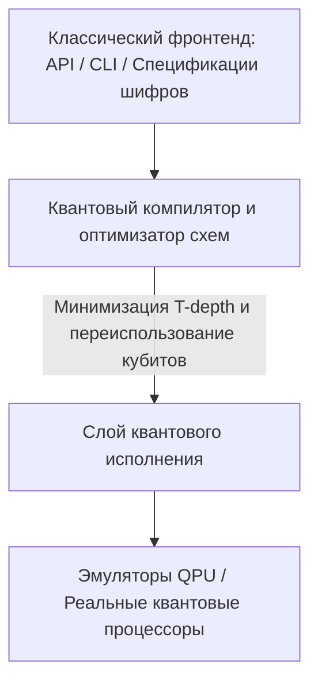

https://h1opok.github.io/crypto-super-bot

# QUANTUM CRYPTANALYSIS CORE V4.0

**QUANTUM CRYPTANALYSIS CORE V4.0** — это концептуальная архитектура программно-аппаратного комплекса, предназначенного для анализа стойкости и взлома классических криптографических алгоритмов с использованием квантовых вычислений. Система сочетает в себе теоретические квантовые оракулы и прикладные инструменты для оптимизации логических схем под архитектуры современных QPU.

---

## 🏛 Архитектура системы (Core Architecture)

Комплекс разделен на три основных уровня, обеспечивающих бесшовную трансляцию классических криптографических задач в квантовое исполнение:

1. **Классический фронтенд (High-Level API):** Принимает на вход параметры исследуемого шифра (открытые ключи, зашифрованные тексты, хэши).
2. **Компилятор схем (Quantum Circuit Optimizer):** Переводит классические функции в квантовые вентили ($X$, $CX$, $T$, $H$), минимизируя общее количество вентилей и T-глубину.
3. **Слой исполнения (QPU Execution Layer):** Направляет оптимизированный код на симуляторы высокого уровня или физические квантовые процессоры.

---

## 🧠 Ключевые аналитические модули

Модификация V4.0 ориентирована на параллельное развертывание двух главных квантовых алгоритмов, представляющих угрозу для современной криптографии:

### A. Модуль факторизации и дискретного логарифма (Алгоритм Шора)
* **Цель:** Анализ и деструкция асимметричной криптографии (**RSA**, **DH**, **ECDSA**).
* **Принцип работы:** Нахождение периода функции $f(x) = a^x \pmod N$ за полиномиальное время.
* **Спецификация V4.0:** Интеграция оптимизированных цепочек модульного возведения в степень. Использование оконных методов сокращает требования к числу кубитов благодаря динамическому переиспользованию регистров памяти.

### B. Модуль ускоренного перебора и коллизий (Алгоритм Гровера)
* **Цель:** Ослабление симметричного шифрования (**AES**) и криптографических хеш-функций (**SHA-2**, **SHA-3**).
* **Принцип работы:** Квантовый поиск в неструктурированной базе данных (пространстве ключей), обеспечивающий квадратичное ускорение ($O(\sqrt{N})$).
* **Спецификация V4.0:** Аппаратная реализация криптографических оракулов в виде квантовых схем с жестким ограничением на количество вспомогательных кубитов (ancilla qubits).

---

## 📊 Матрица уязвимости алгоритмов (Постквантовая оценка)

Ядро V4.0 использует следующую классификацию стойкости текущих криптографических стандартов перед лицом квантовой угрозы:

| Семейство алгоритмов | Алгоритм | Классическая стойкость | Стойкость против Core V4.0 | Статус безопасности |
| :--- | :--- | :--- | :--- | :--- |
| **Асимметричное (RSA)** | RSA-2048 / 4096 | Высокая | **Полный взлом** (Алгоритм Шора) | ❌ Небезопасно |
| **Эллиптические кривые**| ECDSA / ECDH | Высокая | **Полный взлом** (Алгоритм Шора) | ❌ Небезопасно |
| **Симметричное** | AES-128 | Высокая | Снижена до 64 бит (Гровер) | ⚠️ Критично |
| **Симметричное** | AES-256 | Максимальная | Снижена до 128 бит (Гровер) |  Безопасно |
| **Хеширование** | SHA-256 / 512 | Максимальная | Квадратичное ослабление |  Безопасно |

---

## 🛡 Векторы защиты: Миграция на PQC

Помимо анализа уязвимостей, Core V4.0 активно применяется в режиме **защитного (аудиторского) криптоанализа** для стресс-тестирования новых постквантовых стандартов (Post-Quantum Cryptography):

* **Криптография на решетках (Lattice-based):** Оценка устойчивости алгоритмов инкапсуляции ключей (*CRYSTALS-Kyber*) и электронных цифровых подписей (*CRYSTALS-Dilithium*).
* **Хеш-подписи (Stateful/Stateless Hash-based):** Моделирование атак на схемы типа *SPHINCS+* и *XMSS*.

---

## ⚙️ Дисклеймер (Disclaimer)

*Этот проект носит исключительно исследовательский и академический характер. Разработка ведется в целях развития методов превентивной защиты данных и подготовки глобальной ИТ-инфраструктуры к безопасной постквантовой миграции.*
